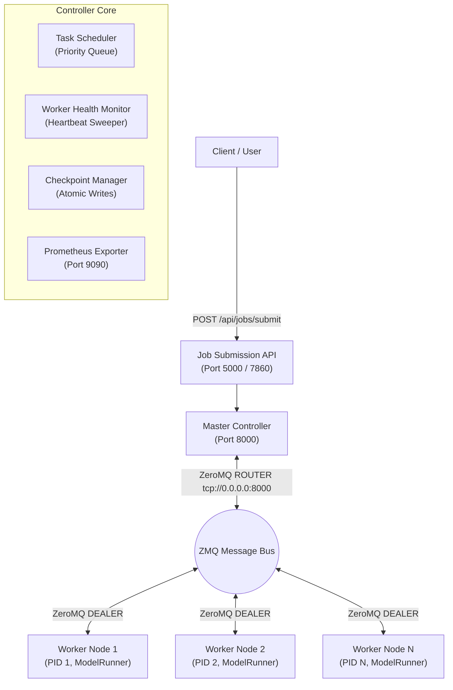

# RMLTP — Distributed Machine Learning Platform

[](https://www.python.org/)
[](https://pytorch.org/)
[](https://zeromq.org/)
[](https://opensource.org/licenses/MIT)

An enterprise-grade, from-scratch distributed ML training platform combining ideas from **Kubernetes** (pod orchestration, health checks, heartbeats), **Ray** (dynamic task scheduling, actor model), and **PyTorch Distributed** (Data Parallelism, Pipeline Parallelism, AllReduce, Parameter Server).

---

## 📚 Table of Contents
1. [Core Features](#-core-features)
2. [Architecture Overview](#-architecture-overview)
3. [Quick Start (Local Multi-Terminal)](#-quick-start-local-multi-terminal)
4. [Live Resilience Demo (Process Kill & Recovery)](#-live-resilience-demo-process-kill--recovery)
5. [Containerization (Docker & Docker Compose)](#-containerization-docker--docker-compose)
6. [Free Cloud Hosting Deployment (Hugging Face Spaces / Render)](#-free-cloud-hosting-deployment)
7. [Study Guide & Documentation](#-study-guide--documentation)
8. [Testing & Verification](#-testing--verification)

---

## 🚀 Core Features

- **True Multi-Process Networking**: Autonomous worker processes communicating over ZeroMQ TCP sockets using non-blocking `ROUTER`/`DEALER` patterns.
- **REST Job Submission API**: Submit jobs with custom training code, dataset location, resource specifications, and worker counts (`/api/jobs/submit`).
- **Distributed Scheduling**: Priority-based scheduling queue with locality-aware worker placement.
- **Worker Registration & Heartbeats**: Autonomous worker daemons report CPU/GPU hardware specs and stream 2-second heartbeats over TCP.
- **Fault-Tolerant Self-Healing**: Live process crash detection with automatic task rescue and reassignment.
- **Distributed ML Primitives**:
  - **Data Parallelism**: `DataParallelExecutor` with dataset sharding.
  - **Pipeline Parallelism**: `PipelineParallelStage` with backward activation propagation.
  - **Synchronization**: Ring-style `AllReduceSynchronizer` and central `ParameterServer` (synchronous and asynchronous with staleness damping $\frac{1}{1 + \tau}$).
- **Advanced Capabilities**:
  - **Gradient Compression**: Top-K gradient sparsification and Gzip serialization.
  - **Distributed Optimizer**: Drop-in PyTorch optimizer wrapper with automatic gradient reduction on `.step()`.
  - **Fault-Tolerant AllReduce**: Collective reduction that automatically excludes dead nodes without barrier deadlocks.
  - **Elastic Scaling**: Dynamic addition and removal of worker nodes with dataset re-sharding.
- **Observability**: Prometheus metrics exporter (`9090`) and interactive Dark-Themed Web Dashboard (`dashboard.py`).

---

## 🏗️ Architecture Overview



---

## 💻 Quick Start (Local Multi-Terminal)

### 1. Install Dependencies
```bash
python -m venv venv
# On Windows:
.\venv\Scripts\activate
# On Linux/macOS:
source venv/bin/activate

pip install -r requirements.txt
```

### 2. Multi-Terminal Demonstration
Open 4 separate terminal windows:

- **Terminal 1: Start Controller Orchestrator**
  ```bash
  python src/controller/main.py --host 127.0.0.1 --port 8000 --mode serve
  ```

- **Terminal 2: Launch Worker Node 1**
  ```bash
  python src/node/main.py --id worker-1 --port 8001 --controller 127.0.0.1:8000
  ```

- **Terminal 3: Launch Worker Node 2**
  ```bash
  python src/node/main.py --id worker-2 --port 8002 --controller 127.0.0.1:8000
  ```

- **Terminal 4: Start Interactive Web Dashboard**
  ```bash
  python dashboard.py --port 5000
  ```
  Open [http://localhost:5000](http://localhost:5000) in your browser to view live telemetry, trigger distributed training steps, and simulate node failures!

---

## ⚡ Live Resilience Demo (Process Kill & Recovery)

Run the automated multi-process resilience demo script:
```bash
python demo_cluster.py
```

This script:
1. Spawns the Controller and two autonomous Workers as real OS subprocesses.
2. Waits for registration handshakes and heartbeats.
3. Forcefully sends `SIGKILL` to Worker 2.
4. Shows the Controller detecting the node crash, marking it dead, and seamlessly failing over tasks to Worker 1.

---

## 🐳 Containerization (Docker & Docker Compose)

### Single-Container Multi-Process Supervisor
```bash
# Build the Docker image
docker build -t rmltp-platform:latest .

# Run container (Dashboard on port 7860)
docker run -p 7860:7860 -p 8000:8000 -p 9090:9090 rmltp-platform:latest
```

### Multi-Container Cluster with Docker Compose
```bash
docker-compose up --build
```
This starts isolated containers for `controller`, `worker-1`, `worker-2`, and `dashboard` connected across an internal bridge network (`rmltp-net`).

---

## ☁️ Free Cloud Hosting Deployment Options (No Credit Card Required)

> [!NOTE]
> Hugging Face recently made their raw *Docker* Space SDK paid / card-verified to curb crypto miners. However, you can still host 100% for free with **Render**, **Koyeb**, or by selecting the **Gradio/Blank Python SDK** on Hugging Face Spaces using our included `app.py`.

### Option 1: Render (100% Free Docker Web Service)
Render deploys raw `Dockerfile` containers completely free without a credit card:
1. Push your repository to GitHub.
2. Sign up for free at [render.com](https://render.com/) (using GitHub OAuth).
3. Click **New +** -> **Web Service** -> Connect your GitHub repo.
4. Render automatically reads our included [render.yaml](render.yaml) and [Dockerfile](Dockerfile).
5. Choose the **Free Plan** and click **Deploy Web Service**.
6. Render builds the container and provides you with a free `https://<your-app>.onrender.com` public URL.

### Option 2: Hugging Face Spaces (100% Free 16GB RAM via Python/Gradio SDK)
If you prefer Hugging Face Spaces' generous 16GB RAM free tier:
1. Create a free account at [huggingface.co](https://huggingface.co/).
2. Click **New Space** -> Choose **Gradio** or **Blank** (NOT Docker) as the SDK -> Free CPU (2 vCPU, 16GB RAM).
3. Push this repository to your Space:
   ```bash
   git remote add space https://huggingface.co/spaces/<username>/<space-name>
   git push space master:main
   ```
4. Hugging Face automatically executes our included [app.py](app.py), which boots the background Controller and Worker daemons over ZeroMQ TCP and serves the interactive dashboard on port `7860`!

### Option 3: Koyeb (100% Free Serverless Containers)
1. Sign up at [koyeb.com](https://www.koyeb.com/) (No credit card required).
2. Create a new App -> Choose **GitHub** -> select your repository.
3. Select **Dockerfile** builder and the **Free Eco Instance** (nano).
4. Koyeb deploys your Docker container with a global CDN URL.

### Option 4: Instant Public URL via Cloudflare Tunnel (Zero-Cloud Option)
If you want to run the platform on your own local PC or GPU while generating a free, secure HTTPS public URL for anyone to test:
```bash
# Start your local cluster / dashboard:
python dashboard.py --port 5000

# In another terminal, download cloudflared and run (no account/card needed):
cloudflared tunnel --url http://localhost:5000
```
Cloudflare gives you an instant `https://<random-id>.trycloudflare.com` link that tunnels straight to your local dashboard!

---

## 📖 Study Guide & Documentation

- [learnings.md](learnings.md): **Comprehensive 10-Chapter Masterclass** covering distributed computing theory, Data/Pipeline Parallelism, SGD math, AllReduce vs Parameter Server, ZeroMQ topologies, fault tolerance, and interview cheat sheets.
- [tasks.md](tasks.md): **30-Point Implementation Checklist** tracking every requirement.
- [specs/proposals/001-real-multiprocess-distributed-platform.md](specs/proposals/001-real-multiprocess-distributed-platform.md): Formal OpenSpec architectural proposal.

---

## 🧪 Testing & Verification

Run the entire 117-test verification suite (unit, integration, and benchmarks):
```bash
pytest -v
```

Run benchmarks for communication overhead and tensor serialization:
```bash
python benchmarks/benchmark_distributed.py
```

---

## 📄 License
MIT License.
